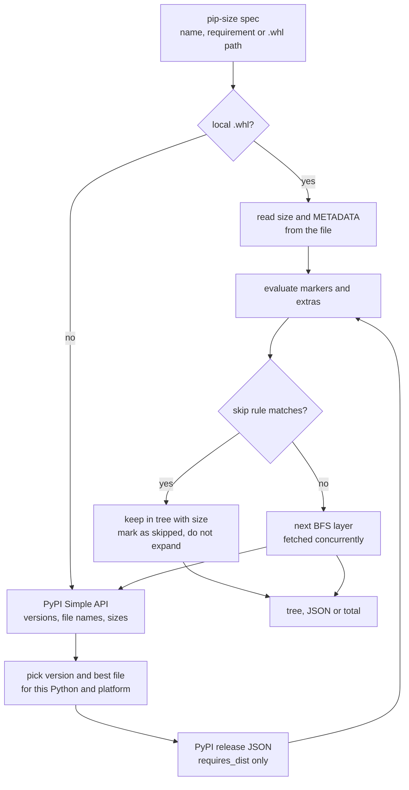

# How it works

`pip-size` never installs or downloads a package. It reads metadata that PyPI already publishes
and applies the same selection rules pip does.

## 1. List the releases

For each package, `pip-size` reads the PyPI [Simple API](https://peps.python.org/pep-0691/) in its
JSON form: every release with its file names and file sizes. A local `.whl` is read from disk
instead.

## 2. Choose a version

The requirement's specifier is matched against the releases, and the **highest matching version
that has a usable file** wins. A file is usable when:

- its `requires-python` accepts the running interpreter, and
- it is a wheel whose tags match the interpreter and platform, or a source distribution.

Yanked files are ignored (unless you pin that exact version). Pre-releases are considered only when
the specifier asks for one, or when nothing else matches. An exact pin (`pkg==1.2.3`) skips the
version listing and asks PyPI for that release directly.

## 3. Choose a file

Compatible wheels are ranked by the interpreter's own tag priority, the order pip uses. The best
wheel wins; a source distribution is used only if no wheel fits. If a matching version has no
usable file at all, it is reported with size `0` and file name `N/A`.

## 4. Read the dependencies

The dependency list (`requires_dist`) of the chosen release is read from PyPI's per-release JSON, or
from `METADATA` for a local wheel. Then:

- **Markers** such as `python_version < "3.11"` or `sys_platform == "win32"` are evaluated for the running interpreter. A dependency whose marker is false is left out.
- **Extras** gate optional dependencies: they are included only for [extras you activated](../guide/extras.md).

## 5. Walk the graph

The graph is explored breadth first. Every layer is fetched concurrently (up to 10 requests at a
time), and each package is resolved once. [Skip rules](../guide/skipping.md) are applied as packages
are reached: a skipped package gets its size and a reason and is not expanded.

## 6. Cache and print

Responses are cached for 24 hours. The tree is sorted by name so that the output is the same from
run to run, and printed as text, JSON, or a single number.

!!! info "Why the Simple API?"
    The Simple API lists every version's files and sizes in one request, and, unlike the older
    `releases` key of the project JSON API, is the interface PyPI intends clients to use. Only the
    dependency list of the chosen release needs a second request.
