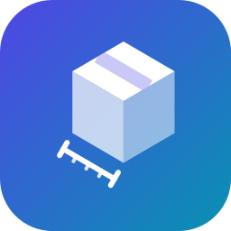

<div class="hero" markdown>

{ width="120" }

# pip-size

**See the real install size of a PyPI package, dependencies included, without downloading anything.**

[Get started](quickstart.md){ .md-button .md-button--primary }
[Python API](python-api/index.md){ .md-button }

</div>

A package's own size says little. What you pay in bandwidth, install time and disk is that
package **plus everything it pulls in**. `pip-size` resolves the full dependency tree from PyPI
metadata and adds it up, from the command line or from Python, without a pip subprocess, a
virtual environment or a single wheel download.

=== "Command line"

    ```bash
    pip install pip-size
    pip-size requests
    ```

    ```text
      requests==2.34.2  71.4 KB  (total: 655.3 KB)
      ├── certifi==2026.10.23  131.9 KB
      ├── charset_normalizer==3.5.2  251.6 KB
      ├── idna==3.20  68.0 KB
      └── urllib3==2.8.0  132.5 KB
    ```

=== "Python"

    ```python
    import pip_size

    res = pip_size.resolve("requests")

    res.total_size                  # 671058, bytes to download
    for pkg in res.packages:        # the whole tree, root first
        print(pkg.name, pkg.version, pkg.size)
    ```

<div class="grid cards" markdown>

-   :material-console:{ .lg .middle } **Command line**

    ---

    Every option, the output format and the exit codes.

    [:octicons-arrow-right-24: Command line](cli.md)

-   :material-language-python:{ .lg .middle } **Python API**

    ---

    `resolve()` and `resolve_async()` return typed result objects and print nothing.

    [:octicons-arrow-right-24: Python API](python-api/index.md)

-   :material-skip-next-circle-outline:{ .lg .middle } **Skip what is installed**

    ---

    Keep numpy, torch or anything already on the target machine in the tree, but out of the total.

    [:octicons-arrow-right-24: Skipping dependencies](guide/skipping.md)

-   :material-package-variant-closed:{ .lg .middle } **Check a wheel you just built**

    ---

    Point it at a `.whl`: its size and metadata are read from the file.

    [:octicons-arrow-right-24: Local wheels](guide/local-wheels.md)

-   :material-source-branch-check:{ .lg .middle } **Built for CI**

    ---

    One number on stdout, clean JSON, and a non-zero exit status when something cannot be resolved.

    [:octicons-arrow-right-24: Use in CI](guide/ci.md)

-   :material-cog-outline:{ .lg .middle } **How it works**

    ---

    PyPI Simple API, wheel selection, markers and extras, and the limits to keep in mind.

    [:octicons-arrow-right-24: How it works](concepts/how-it-works.md)

</div>
